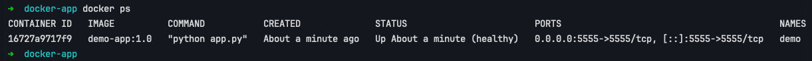
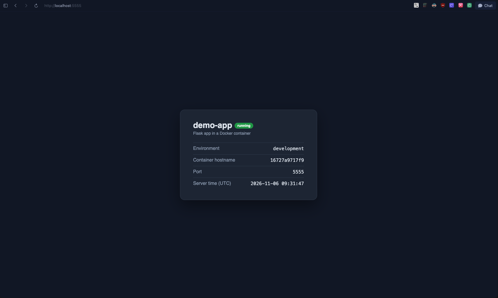

# docker-app

A small Flask web app packaged with Docker and run with Docker Compose. It shows the app name, environment, container hostname and server time, and has a `/health` endpoint for health checks.

## Project structure

```
docker-app/
├── app/
│   ├── app.py              # Flask app
│   └── requirements.txt    # dependencies
├── Dockerfile
├── docker-compose.yaml
├── .env.example            # example settings
├── .dockerignore
└── .gitignore
```

## How to run

```bash
cp .env.example .env
docker compose up -d --build
```

Open http://localhost:5555 in the browser. The health endpoint is http://localhost:5555/health.

Stop and remove the container:

```bash
docker compose down
```

## Configuration

Settings are passed through `.env`:

| Variable | Description |
|---|---|
| `APP_NAME` | App name shown on the page |
| `APP_ENV` | Environment name (`development`, `production`) |
| `PORT` | Port the app listens on inside the container |

`.env` is not committed, only `.env.example`.

## Commands used

| Command | What it does |
|---|---|
| `docker build -t demo-app:1.0 .` | Build the image with a version tag |
| `docker compose up -d --build` | Build and start the container |
| `docker ps` | Check that the container is running and healthy |
| `docker compose logs -f` | Follow app logs |
| `docker inspect demo` | Check config and health check results |
| `docker compose down` | Stop and remove the container |

## Architecture

```
Browser → localhost:5555 → container "demo" (Flask on port 5555)
```

- **Multi-stage build**: dependencies are installed in a separate stage, the final image gets only what it needs, so it stays small.
- **Pinned base image**: `python:3.12-slim` instead of `latest`.
- **Non-root user**: the app runs as user `app`.
- **Health check**: Docker calls `/health` every 30 seconds, the status shows `(healthy)`.
- **Restart policy**: `unless-stopped`, the container restarts after a crash.

## Screenshots

Running container:



App in the browser:


